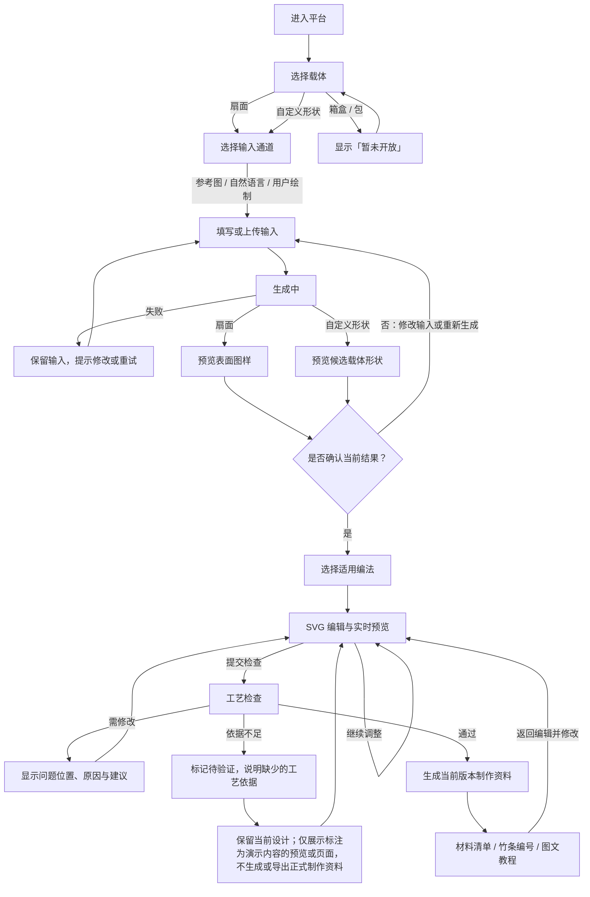

# 页面与状态流程（产品负责人已确认）

> 目标：确定可点击的页面路径与返回关系。此图不表示生成、SVG 编辑、工艺检查或教程已经实现；也不决定尚待团队确认的数据字段和工艺数值。

## 页面状态与动作

| 页面 | 主要动作 | 必须显示的状态 |
| --- | --- | --- |
| 选载体 | 选扇面或自定义形状；箱盒、包只可查看 | 当前选择、暂未开放提示 |
| 输入 | 切换三种通道、提交、返回选载体 | 当前载体、原始输入、生成中 / 失败 |
| 结果确认 | 预览、确认、修改输入、重新生成 | 扇面为表面图样；自定义为候选载体形状；未确认状态 |
| 选编法 | 选适用编法、返回确认结果 | 当前载体、已确认结果、编法适用提示 |
| SVG 编辑 | 调参数、实时看预览、提交检查 | 当前设计版本、预览计算中 / 已更新 |
| 工艺检查 | 看结果、回编辑修改 | 需要修改：显示位置、原因和建议；依据不足：说明缺少的依据并标记待验证；通过：进入当前版本制作资料 |
| 制作资料 | 看材料、编号、图文步骤；返回编辑 | 对应设计版本；修改后旧资料失效 |

## 贯穿全程的状态规则

1. 用户未确认图样或形状，不进入编法编辑。
2. 变更载体、输入或生成结果后，下游编法、检查和教程需要重新计算或重新确认。
3. 修改形状、图样、编法或工艺参数后，旧检查及教程立即标记为过期；仅页面缩放和平移不影响有效性。
4. 工艺资料不足时保留当前设计和演示 SVG，说明缺少的工艺依据并标记“待验证”；可进入明确标注为演示内容的页面，不生成或导出正式制作资料。
5. 生成失败保留原始输入；检查不通过保留当前设计，方便用户修正。

## 已确认的关键页面规则

1. 箱盒、包点击后显示“暂未开放”并停留在选载体页。
2. 自定义形状与扇面共用后续页面，但结果确认页分别显示“候选载体形状”和“表面图样”。
3. 已确认：检查为“待验证”时，保留设计并说明缺少的工艺依据；只允许查看标注为演示内容的页面，不生成或导出正式材料清单、编号和教程。
4. 用户修改已生成教程的设计后，旧教程标记过期并需重新检查。
